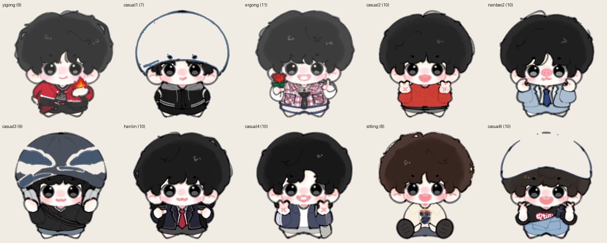
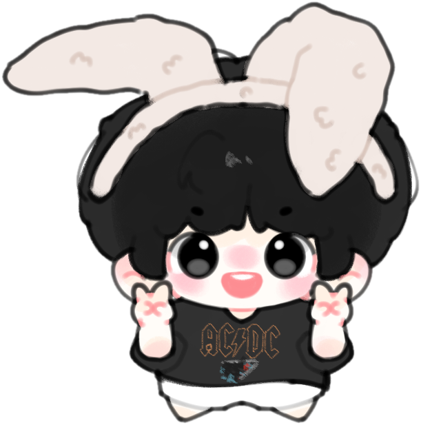
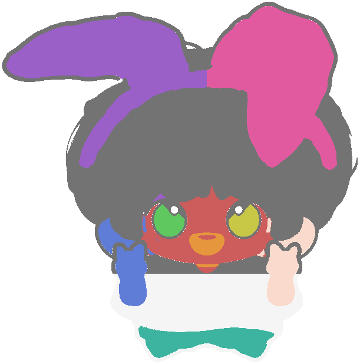
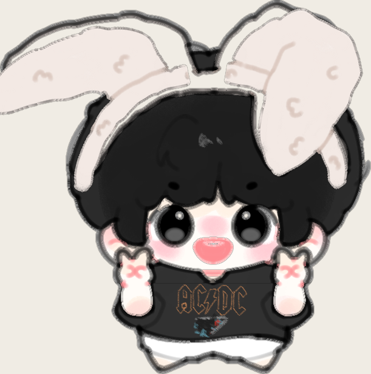

# 兔耳小人 · 可换肤桌面宠物

<p align="left">
  
  
  
  
</p>

> 从**一张单层插画**，到一套可换肤的角色动画系统 —— 自动切层算法 + 声明式皮肤系统 + Web / Windows 双端运行时。

<p align="center">
  
</p>

<p align="center">
  <a href="https://bunny-desk-pet.app.workbuddy.host/"><b>▶ 在线体验（网页版）</b></a>
  &nbsp;·&nbsp;
  <a href="作品集/兔耳桌宠-项目案例.md"><b>项目案例文档</b></a>
  &nbsp;·&nbsp;
  <a href="作品集/index.html"><b>作品集页面</b></a>
</p>

---

## 它是什么

输入只有画师绘制的**白底合层插画**：没有分层、没有骨骼、没有动画，更没有 Live2D 源文件。

这个项目用图像算法把合层图**逆向分层**成 11 个带枢轴的部件，再用"枢轴旋转"替代 Live2D 模拟骨骼运动，最终交付一套完整的桌宠产品：

- **11 套皮肤**，新增一套只需一条命令
- **8 种交互状态**：待机 / 戳 / 拖拽 / 坠落 / 睡眠 / 醒来 / 行走 / 闲聊
- **111 条台词**，按状态 + 权重 + 冷却构成状态机，不会复读
- **双端同源**：同一份 `skins/` 资产同时驱动网页版与 Windows 桌面端（WPF，零第三方依赖）

## 快速开始

**网页版** — 直接用浏览器打开：

```
pet-assets/pet-demo-skins.html
```

或用浏览器访问线上版本：<https://bunny-desk-pet.app.workbuddy.host/>

**Windows 桌面版** — 需要 PowerShell 5.1（Win10/11 自带）：

```powershell
powershell -ExecutionPolicy Bypass -File pet-assets/deskpet/DeskPet.ps1
```

或双击 `pet-assets/deskpet/启动桌宠.vbs`（无控制台窗口启动）。

> 桌面端会自动创建桌面快捷方式；右键托盘图标可切换皮肤、开机自启、退出。

## 效果

| 抠图母版（算法输入） | 连通域切分中间产物 |
|---|---|
|  |  |

<p align="center">
  
  <br><sub>部件围绕枢轴独立运动，耳朵摆动无阴影残留、无接缝</sub>
</p>

## 技术路线

原始素材皮肤、兔耳、短裤**全是白色系**，颜色聚类完全失效。所以切层不依赖颜色，而是利用画师的描边习惯 —— 每个部件都被闭合的暗色轮廓包围：

```
暗色描边提取（V < 150）
   ↓  形态学腐蚀 ×5，切断抗锯齿像素造成的区域桥接
连通域标记（ndimage.label）
   ↓  取前 2 个最大暗色核心定位眼睛，避免被刘海轮廓吸走
距离变换测描边厚度（区分"细描边"与"大面积暗色填充"如头发）
   ↓  最近邻像素按区域归属
1–2px 出血 + 0.7px alpha 羽化（消除白边）
```

切分结果重组后与原图逐像素几乎一致。

| 模块 | 文件 | 作用 |
|---|---|---|
| 抠图 | `tools/cut_bg.py` `tools/cut_master.py` | 边缘洪水填充，保留内部白色（短裤、眼睛高光） |
| 切层 | `tools/petsplit.py` `tools/split_layers.py` | 描边拓扑切分 + 枢轴计算 |
| 皮肤接入 | `tools/ingest_skin.py` `tools/batch_ingest.py` | 单套 / 批量导入，自动归一化到 640 画布、脚底基线 616 |
| 构建 | `tools/build_skins.py` | 校验必填层、合并台词池、生成 `skins.json` |
| 打包 | `tools/build_share.py` | 生成分发 zip 与静态站点 |
| 测试 | `tools/test_drag.js` | jsdom 无头回归：拖拽位移、11 套皮肤加载 |

## 皮肤系统

每套皮肤是一个自包含目录，声明式配置驱动全部行为：

```
skins/default/
├── skin.json      # canvas / baseline / accent / layers / pivots / anim / quotes
├── layers/        # 各部件 PNG（带出血）
└── thumb.png      # 缩略图
```

```json
{
  "id": "default",
  "canvas": [640, 640],
  "baseline": 616,
  "accent": "#C23B3B",
  "layers": [{ "role": "ear_L", "src": "layers/ear_L.png", "label": "左耳" }],
  "pivots": { "ear_L": [257, 361], "eye_L": [262, 396] },
  "anim": { "breathe": true, "blink": true, "earSway": true }
}
```

**加一套新皮肤：**

```bash
python tools/ingest_skin.py <原图.png> casual7 "常服 · 新造型" --accent "#4A6FA5"
python tools/build_skins.py
```

如果原图的耳朵没有独立分层，加上 `--static-ears`：耳朵保持静止，但眨眼、呼吸、点头等动画照常保留 —— 保证任何画风的原图都能无痛接入。

## 目录结构

```
.
├── pet-assets/
│   ├── tools/            # 抠图、切层、皮肤接入、构建、测试
│   ├── character/        # 主皮肤母版与切层产出
│   ├── skins/            # 11 套皮肤（每套自包含）
│   ├── deskpet/          # PowerShell + WPF 桌面端（DeskPet.ps1, 716 行）
│   ├── pet-demo-skins.html   # 网页版主演示
│   ├── 台词表.csv         # 111 条台词（skin, state, text, weight, cooldown）
│   └── 皮肤包规范.md      # 皮肤包格式说明
├── 作品集/                # 项目案例文档与可视化页面
└── docs/                 # README 配图
```

`pet-assets/dist/` 为构建产物，已被 gitignore 忽略；需要分发时运行 `python tools/build_share.py` 重新生成。

## 量化数据

| 指标 | 数值 |
|---|---|
| 皮肤 | 11 套（主皮肤 11 层，其余 7–10 层） |
| 切图资产 | 367 张 PNG / 421 个文件 / 21MB |
| 台词 | 111 条（idle 65 · poke 18 · drag 8 · fall 7 · sleep 7 · wake 6） |
| 桌面端 | `DeskPet.ps1` 716 行，零第三方依赖 |
| 分发包 | 4.5MB zip，解压即用，全相对路径 |
| 测试 | 拖拽位移 dx≈106 / dy≈318，11 套皮肤 0 运行时错误 |

## 已知取舍

- **未使用 Live2D / Spine**：两者都要求人工分层源文件，无法支撑"持续加皮肤"的流水线需求，且学习成本高于项目收益。代价是缺失网格形变，表情变化依赖贴图切换而非参数化。
- **切层依赖画师的描边习惯**：若原图没有闭合描边（厚涂无描边风格），暗色拓扑方法会失效，需退回手工分层。
- **桌面端为单文件脚本**：选择 PowerShell + WPF 是为了"解压即用、零依赖"，代价是无法打包成独立 exe 单文件（需用户允许脚本执行）。

## 版权说明

角色原画版权归原画师所有，本项目中的美术资源**不可**用于商业用途。
代码部分可用于学习与参考。如需引用，请注明出处。

---

<sub>独立开发 · <b>Wang Shuxin</b> ｜ 详细的技术难点、简历话术与面试讲法见 <a href="作品集/兔耳桌宠-项目案例.md">项目案例文档</a>。</sub>
